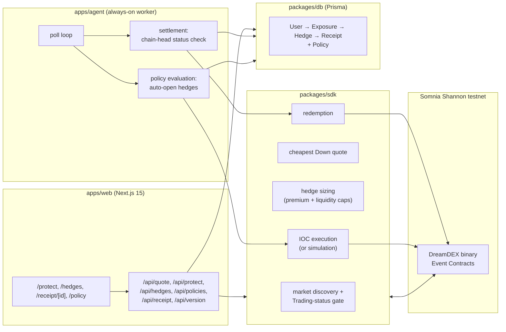

<div align="center">

# Watchman

**Short-duration downside protection for BTC and ETH, built on DreamDEX Event Contracts.**

Keep the position, buy the downside event, and get a receipt that shows what the hedge actually did.

[Live app](https://watchman-beta.vercel.app/) · [Deploy guide](DEPLOY.md) · [Demo script](DEMO_SCRIPT.md)


</div>

> [!IMPORTANT]
> Watchman runs on the **Somnia Shannon testnet only**. Collateral is testnet tUSDC, and every chain constant is pinned to testnet in [`packages/sdk/src/config.ts`](packages/sdk/src/config.ts). There is no mainnet support.

## Contents

- [What it does](#what-it-does)
- [Why a binary contract is not a put](#why-a-binary-contract-is-not-a-put)
- [Try it](#try-it)
- [How it works](#how-it-works)
- [Risk model](#risk-model)
- [Tech stack](#tech-stack)
- [Run it locally](#run-it-locally)
- [Configuration](#configuration)
- [Testing](#testing)
- [Deployment](#deployment)
- [Project structure](#project-structure)
- [Status and limitations](#status-and-limitations)
- [License](#license)

## What it does

Holding BTC or ETH through a volatile window, such as a CPI print, a token unlock or the next 15 minutes, usually means choosing between two bad options. You can sell and give up the position, or hold and take the drawdown. Perp hedges add funding costs and liquidation risk.

DreamDEX lists short-duration binary Event Contracts on Somnia that can hedge that window, but they are a raw trading primitive. Watchman is the layer on top. You give it three inputs:

- an exposure,
- a protection percentage,
- a premium budget.

Watchman then runs the whole pipeline:

| Step | What Watchman does |
|---|---|
| **Discover** | Finds BTC or ETH binary markets (15-minute or 1-hour windows) that are currently `Trading` on-chain |
| **Quote** | Picks the cheapest Down price from the live order book |
| **Size** | Sizes the hedge to your protection target, capped by your premium budget and the liquidity actually on the book |
| **Execute** | Places an IOC order, or simulates it in Demo mode |
| **Settle** | A worker watches the market resolve, using the on-chain status rather than a cached indexer row |
| **Redeem** | Redeems the winning side |
| **Receipt** | Writes a Hedge Receipt showing unhedged P&L, hedged P&L, net protection and efficiency |

Watchman never predicts direction. It only buys the Down side to offset an existing long.

## Why a binary contract is not a put

A binary Event Contract pays its full face value or nothing. It does not grow with the size of the move the way a put's intrinsic value does, so the payout will rarely equal your actual loss.

Watchman does not hide that gap, which is called basis difference. Every receipt shows unhedged P&L next to hedged P&L and states the efficiency of the hedge, instead of a single "you were protected" figure.

## Try it

Open **[watchman-beta.vercel.app](https://watchman-beta.vercel.app/)** and click **Try demo**. You don't need a wallet or funds.

1. **`/protect`** opens in **Demo mode** with these defaults:
   - $10,000 BTC exposure
   - 50% protection
   - a 1-hour window
   - a $150 premium budget
2. **Review the quote.** It comes from a live DreamDEX Down market. An amber **Simulated order** badge means nothing will be written on-chain.
3. Click **Protect position**, then track the hedge under **`/hedges`**.
4. **Open the Hedge Receipt** once the window resolves and the agent has settled it. It opens with a one-line summary, *What the hedge actually did*, followed by exposure, premium, actual move, payout, unhedged vs. hedged P&L, net protection and efficiency.

**Policies.** **`/policy`** stores a standing rule. The agent evaluates it on each poll and opens hedges automatically.

**Wallet mode.** This mode places real IOC orders on testnet when the server holds a `PRIVATE_KEY`, and the badge then reads **Live testnet execution**.

> [!NOTE]
> Demo mode runs the real quoting and sizing code against live DreamDEX data and skips only the on-chain order and redemption writes. If no market has usable Down liquidity at that moment, the quote panel says so rather than inventing a price.

## How it works



Each agent tick runs three things in order: it reconciles any hedge stuck in `EXECUTING`, settles open hedges, then evaluates policies.

**The chain is the authority.**

1. Indexed market data drives discovery.
2. `getMarketOnchain(marketId).status` is re-checked right before every quote, every order and every redemption.
3. Watchman keys markets by their bytes32 `marketId`, because DreamDEX recycles binary pool addresses across markets and a pool address alone is not a safe identity.

## Risk model

For a hedge with exposure `E`, protection fraction `p`, Down price `q` and `n` contracts:

```text
protected amount = E × p
premium          = n × q
potential payout = n          (each contract pays $1 face value)
```

At settlement the agent pays out net of the market's settlement fee, and a voided market pays half.

`n` is capped by both the premium budget and the Down liquidity currently on the book. Watchman never sizes past what it can fill.

After settlement:

```text
unhedged P&L   = exposure × actual move
hedged P&L     = unhedged P&L + payout − premium
net protection = hedged P&L − unhedged P&L
efficiency     = net protection / premium
```

The live deployment exposes a worked example of this math at [`/api/version`](https://watchman-beta.vercel.app/api/version) (the `showcase` block), with consistency checks.

## Tech stack

| Layer | Technology |
|---|---|
| Frontend | Next.js 15 (App Router), React 19, TypeScript, Tailwind CSS v4 |
| Wallets | RainbowKit + wagmi + viem |
| Backend | Next.js Route Handlers (quoting, execution) and a standalone Node worker run with `tsx` (settlement, policies) |
| Data | Postgres (Neon) via Prisma: `User`, `Exposure`, `Hedge`, `Receipt`, `Policy` |
| Chain | `@somnia-chain/markets-sdk` for DreamDEX discovery, order book, IOC orders and redemption |
| Network | Somnia Shannon testnet, chain `50312`. Collateral tUSDC `0x70a86D8842FB63C4Ad2b7cdddF530eBf1BB25d8E` (6 decimals) |
| Hosting | Vercel (web) and Railway (agent) |
| Tests | Vitest |

## Run it locally

**Prerequisites:** Node 22 (the version CI uses), pnpm 10.15 (pinned in `packageManager`), and a Postgres database.

```bash
git clone https://github.com/levithefirst/Watchman.git
cd Watchman
pnpm install
cp .env.example .env          # set DATABASE_URL at minimum
pnpm db:generate
pnpm db:migrate               # prisma migrate dev
pnpm dev:web                  # http://localhost:3000
```

Run the settlement and policy agent in a second terminal:

```bash
pnpm dev:agent
```

Leave `PRIVATE_KEY` unset to work entirely in simulation. Quoting and sizing still hit live DreamDEX markets; only the on-chain writes are skipped.

| Script | What it does |
|---|---|
| `pnpm dev:web` | Next.js dev server for `apps/web` |
| `pnpm dev:agent` | Runs the agent with `tsx` |
| `pnpm db:generate` | `prisma generate` |
| `pnpm db:migrate` | `prisma migrate dev` |
| `pnpm db:migrate:deploy` | `prisma migrate deploy` (production) |
| `pnpm typecheck` | `tsc --noEmit` in every workspace |
| `pnpm test` | SDK unit tests (hedge sizing, config) |
| `pnpm build` | `prisma generate`, then every workspace's build, including `next build` |

## Configuration

Every variable is documented in [`.env.example`](.env.example).

| Variable | Where | Required | Purpose |
|---|---|---|---|
| `DATABASE_URL` | web + agent | Yes | Postgres connection string. Both services must use the same database. |
| `PRIVATE_KEY` | web + agent | No | Somnia testnet wallet key. If unset, orders and redemptions are simulated. Never commit it, and never use a wallet that holds anything real. |
| `SETTLEMENT_POLL_MS` | agent | No | Poll interval for settlement and policies (default `10000`). |
| `SOMNIA_WS_RPC_URL` | web + agent | No | WebSocket RPC (default `wss://api.infra.testnet.somnia.network/ws`). The markets SDK has no HTTP fallback. |
| `NEXT_PUBLIC_WALLETCONNECT_PROJECT_ID` | web | No | Turns on the WalletConnect option in the wallet picker. Injected wallets work without it. |
| `VENUE_ID` / `OPERATOR_ID` | web + agent | No | Restrict market discovery to one venue or operator. |

In production (`NODE_ENV=production`) the development faucet route `/api/faucet` is disabled.

## Testing

```bash
pnpm typecheck                          # all workspaces
pnpm test                               # packages/sdk: 39 tests
pnpm --filter @watchman/web test        # apps/web route tests: 26 tests
```

The web tests cover `/api/quote` and `/api/protect`, including the rule that a deployment never asks for a live order it cannot authorise. Note that the root `pnpm test` runs only the SDK suite.

## Deployment

Step-by-step instructions are in **[DEPLOY.md](DEPLOY.md)**.

| Service | Host | Config |
|---|---|---|
| `apps/web` | Vercel, Root Directory `apps/web` | [`apps/web/vercel.json`](apps/web/vercel.json): `pnpm install --frozen-lockfile`, then `pnpm --filter @watchman/web build` |
| `apps/agent` | Railway, always-on worker (not a cron job) | [`railway.json`](railway.json): runs `prisma migrate deploy` before deploy, then `pnpm --filter @watchman/agent start` |

`packages/db` and `packages/sdk` ship as TypeScript source. `transpilePackages` in `next.config.ts` compiles them inside the web build, and the agent runs them directly through `tsx`.

A GitHub Actions workflow, [`fix-next-security.yml`](.github/workflows/fix-next-security.yml), runs on pushes to `main` and pins `next@15.5.21`.

## Project structure

```text
apps/
  web/        Next.js app: pages (/protect, /hedges, /receipt, /policy) and API routes
  agent/      settlement + policy worker (src/index.ts)
packages/
  sdk/        DreamDEX discovery, quoting, sizing (hedge-engine.ts), execution, redemption, testnet config
  db/         Prisma schema, migrations and client
DEPLOY.md     deployment guide
DEMO_SCRIPT.md, SUBMISSION.md   hackathon demo and submission text
```

## Status and limitations

Watchman was built as a hackathon project and runs on testnet.

**Checked on 2026-10-26:**
- The live app serves commit `fd5c3f3` (the head of `main`).
- The `/api/hedges` and `/api/policies` routes returned errors, which suggests the deployment's database is unavailable.
- The quote endpoint answered "no live Trading market with usable Down liquidity", so whether the demo flow can complete depends on testnet liquidity at that moment.

**Design limits:**
- **Binary contracts are not puts.** A Down contract pays a fixed amount however far the market moves. Receipts show this gap rather than hiding it.
- **Coverage ends with the contract's window.** A 15-minute or 1-hour contract only covers moves inside that window. Watchman does not roll a hedge into the next window.
- **Sizing is liquidity-limited.** If the cheapest Down market can't fill the full protection, Watchman fills what it can and reports the shortfall. It does not spread the order across several markets.
- **Demo numbers are real, execution is not.** Demo mode is not a mocked walkthrough, but it is not a funded position either.

## License

MIT. See [LICENSE](LICENSE).
